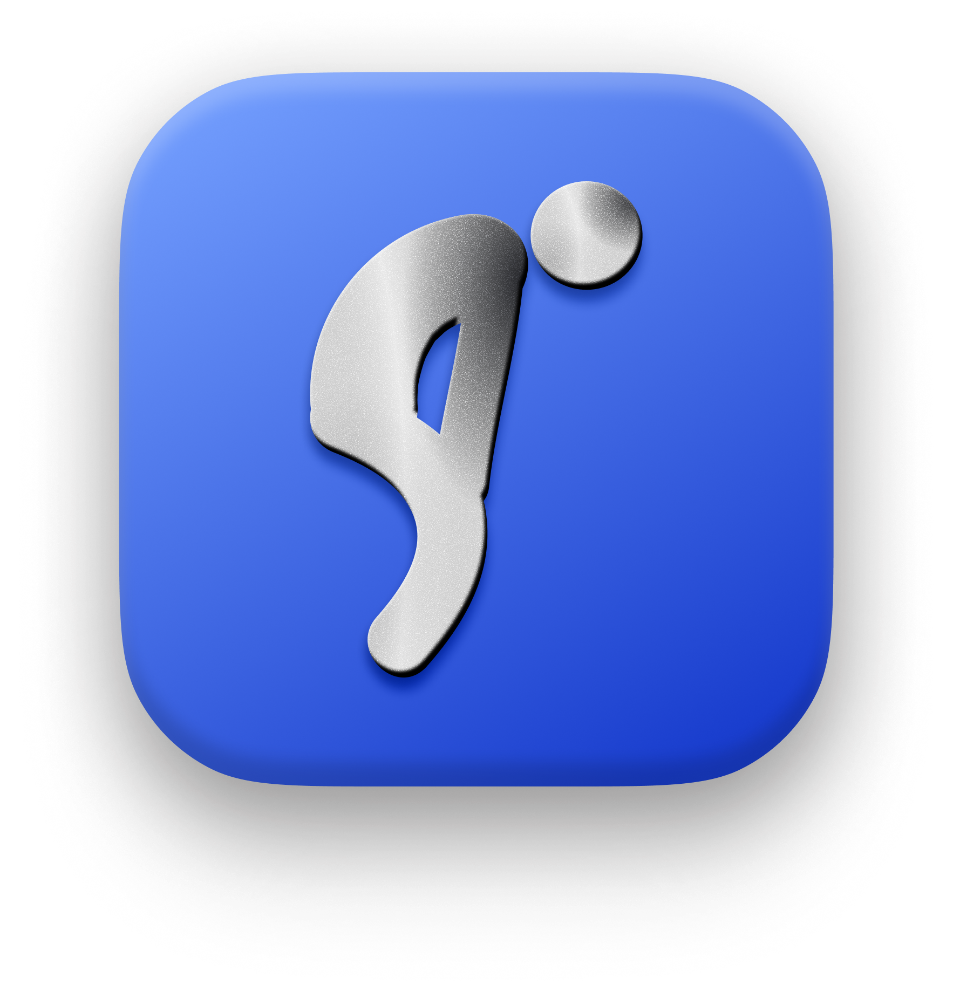

<p align="center">
  
</p>

# ItsMyBack

**A gentle posture reminder for your Mac. Private by design, right in your menu bar.**

ItsMyBack uses your camera and Apple Vision to notice changes in your seated head position. Calibrate while sitting comfortably upright, get a small reminder when you drift, and see a local summary of your tracked time. Camera frames are processed on your Mac and discarded.

No accounts. No recordings. No uploads. No cloud service.

> **Not notarized by Apple.** The current app is distributed without Apple notarization, so macOS may block its first launch. The source is available here so you can inspect the implementation and build it yourself. Source availability does not replace notarization or guarantee that a downloaded binary matches the source. See [installation](#installation) for both options.

[Installation](#installation) · [First-time setup](#first-time-setup) · [Privacy](#privacy-and-local-data) · [Troubleshooting](#troubleshooting) · [Development](#development) · [Contributing](#contributing)

## Features

- **Personal calibration:** establish a baseline for your own upright seated position.
- **Gentle reminders:** animated alerts at the notch, or a top-center island on displays without a notch, without taking keyboard focus.
- **Useful feedback:** alerts for posture reminders, recovery, lost tracking, calibration, and pausing. Brief tracking misses are filtered before showing a lost-tracking alert.
- **Adjustable detection:** choose sensitivity, check frequency, confirmation readings, and time between reminders.
- **Optional notification channels:** enable macOS banners and sound when you want them.
- **Camera control:** pause manually or automatically while idle, asleep, locked, or during supported camera interruptions.
- **Local history:** a seven-day chart of upright and slouching time, with up to 90 daily records retained.
- **Native macOS interface:** SwiftUI settings, optional launch at login, alert appearance choices, and Reduce Motion support.

## Requirements

| | Requirement |
| --- | --- |
| Operating system | macOS 14 Sonoma or later |
| Hardware | Apple Silicon or Intel Mac with a compatible camera |
| Permissions | Camera access; notification permission only for optional macOS banners |
| To build from source | Full Xcode with Swift 6 support (Xcode 16 or later); release compilation verified with Xcode 26.2 |

The release project targets both Apple Silicon and Intel. Intel runtime behavior still needs testing on physical hardware. A physical notch is not required. An internet connection is needed to obtain the source or app, but not for posture monitoring.

## Installation

### Option 1: Install a packaged app

Check this repository's [Releases page](https://github.com/CoDesign-Spa27/backbone/releases) for a packaged download. If no release asset is available, use the source-build instructions below. GitHub's automatically generated source ZIP is source code, not an installable app.

1. Download `ItsMyBack.dmg` from a release published by this project.
2. Open the disk image and drag **ItsMyBack** into **Applications**.
3. Eject the disk image.
4. Open **ItsMyBack** from Applications. Keep the installed app there, especially if you enable launch at login.
5. If macOS blocks the launch because the developer cannot be verified or Apple cannot check the app, follow the next section.

If a release provides an app ZIP instead, extract it and move `ItsMyBack.app` into Applications before opening it.

### Open the app when macOS blocks it

For an unnotarized app you have chosen to trust:

1. Try opening **ItsMyBack** from Applications once, then dismiss the warning.
2. Open **System Settings → Privacy & Security**.
3. Scroll to the security message about ItsMyBack and click **Open Anyway**, if offered.
4. Authenticate if requested and confirm **Open**.

This creates an exception for the app. Menu wording can vary by macOS version. Follow [Apple's guide to safely opening apps](https://support.apple.com/en-us/102445) for the current steps. If macOS reports malware or that the app will damage your computer, do not treat that as the ordinary unidentified-developer prompt. If an organization manages your Mac, its policy may prevent an exception.

### Option 2: Build from source

A local build uses an **ad-hoc signature**: no paid Apple Developer membership, Developer ID certificate, or notarization credentials are needed for the included local build script.

1. Install the full **Xcode** application, open it once, and complete its initial setup. Command Line Tools alone do not include the Xcode app build system.
2. Check the selected developer tools:

   ```sh
   xcode-select -p
   xcodebuild -version
   swift --version
   ```

   If the selected path points to `/Library/Developer/CommandLineTools`, select Xcode in **Xcode → Settings → Locations → Command Line Tools**, or run this command for a standard installation:

   ```sh
   sudo xcode-select --switch /Applications/Xcode.app/Contents/Developer
   ```

3. Clone and build:

   ```sh
   git clone https://github.com/CoDesign-Spa27/backbone.git
   cd backbone
   ./scripts/build.sh
   ```

4. Find the built app in Finder:

   ```sh
   open build/Build/Products/Release
   ```

   Quit any running copy of ItsMyBack, then drag `ItsMyBack.app` into Applications and open it there. For a quick development run, you can instead use:

   ```sh
   open build/Build/Products/Release/ItsMyBack.app
   ```

To work in Xcode, open `PostureBuddy.xcodeproj`, choose the **PostureBuddy** scheme and **My Mac** destination, then build and run. `PostureBuddy` is the internal project name; the resulting app is **ItsMyBack**. The shell build above explicitly configures ad-hoc signing if Xcode's signing settings cause problems.

## First-time setup

1. **Enable the camera.** Read the privacy explanation, click **Enable camera**, and allow access in the macOS prompt. Choosing **Set up later** leaves monitoring off.
2. **Check your framing.** Use the live preview to keep your whole face and both shoulders in view. Face the camera, use even lighting, and keep other people out of frame.
3. **Calibrate.** Sit comfortably upright and click the calibration button. Stay steady while the app collects 20 usable readings, usually about 10 seconds. Calibration times out after 45 seconds if it cannot collect a stable baseline.
4. **Finish setup.** Click **Finish setup**. ItsMyBack lives in the menu bar; it does not keep a normal Dock icon or main window open.
5. **Try a reminder.** Choose **Preview notch alert** from the menu or Settings. Notch alerts work without macOS notification permission.
6. **Tune it to your desk.** Open **Settings & history** to adjust detection, appearance, sound, and optional system notifications.

Recalibrate after moving your camera, changing your chair, or adjusting your screen. Failed or cancelled recalibration preserves the previous valid baseline. Changing cameras may require a new calibration.

## Everyday use

| Control | What it does |
| --- | --- |
| Pause | Stops camera capture temporarily while keeping the monitoring session enabled |
| Resume / I'm back | Resumes a manual or idle pause |
| Stop monitoring | Stops capture and disables automatic session restoration on later launches |
| Recalibrate | Learns a new upright baseline |
| Launch at login | Starts the app when you log in; opt-in |
| Clear history | Deletes recorded daily totals while keeping preferences and calibration |

By default, monitoring pauses after five minutes without keyboard or mouse input. Activity or **I'm back** resumes an idle pause. Setup and calibration are exempt from idle pausing. Manual, idle, sleep, lock, and camera-interruption pauses are tracked independently, so waking your Mac does not cancel a manual pause.

A previously enabled monitoring session is restored on later launches when camera access is available.

### Default settings

| Setting | Default |
| --- | --- |
| Check interval | 0.5 seconds |
| Slouch confirmation | 2 consecutive readings |
| Sensitivity tolerance | 18% |
| Time between reminders | 90 seconds |
| Animated notch alerts | On |
| macOS notifications | Off |
| Sound | Off |
| Pause after 5 minutes away | On |

Confirmation controls how quickly the first reminder appears. Reminder spacing controls repeated reminders while slouching continues. Recovery needs two clearly upright readings to reduce flicker.

System banners require notification permission and follow macOS Focus settings. Direct notch alerts follow the app's reminder settings and can appear while Focus is on. Disable **Gentle posture reminders** when you want monitoring without reminders.

## Privacy and local data

Camera analysis uses Apple's Vision framework on your Mac. The app does not save photos or video, upload frames, use accounts, or include analytics. Its [sandbox entitlements](Resources/PostureBuddy.entitlements) allow camera access and contain no network entitlement.

The camera stays active while monitoring, even between analysis samples. The macOS camera indicator is expected to stay on. Pause, stop monitoring, or quit to release the camera.

Locally stored data includes:

- Detection and reminder preferences.
- Calibration baseline, camera identifier, and calibration date.
- Onboarding completion and whether monitoring was enabled.
- Daily upright/slouching time and reminder counts, retaining at most 90 daily records.

For the default bundle identifier, data is stored at:

```text
~/Library/Containers/com.sandeep.backbone/Data/Library/Application Support/PostureBuddy/data.json
```

Finder may show the container using the app's display name. Builds with a different bundle identifier use a different container. Writes are atomic; unreadable data is backed up before replacement, and saving is disabled if that backup cannot be made.

History reflects usable, calibrated samples. It excludes paused time, calibration, and missing detections, so percentages do not describe your entire workday. Reminder counts reflect requested reminders, which macOS may suppress.

## How detection works and its limits

ItsMyBack compares head position against your calibrated baseline. It detects a face and measures chin height normalized by face size. Lowering your head or leaning toward the camera can reduce that score. Rotated, obscured, very small, or multiple faces can prevent a usable reading.

This is a posture-awareness aid, not a medical device or a clinical measurement. It does not reconstruct your spine, identify every kind of slouching, or reliably distinguish all ordinary head movements from posture changes. Lighting, camera angle, seating, and individual proportions affect results.

CPU usage, battery impact, and detection accuracy vary with hardware and conditions. No measured battery-life or clinical-accuracy claims are made.

## Troubleshooting

| Problem | What to try |
| --- | --- |
| macOS blocks the first launch | Follow [the opening instructions](#open-the-app-when-macos-blocks-it) above for the expected unnotarized-app warning |
| No app window or Dock icon | Find ItsMyBack in the menu bar; it is a menu-bar app |
| Camera permission denied | Enable ItsMyBack in **System Settings → Privacy & Security → Camera**, then try the camera again; relaunch if needed |
| Camera unavailable or disconnected | Close other camera sessions, reconnect an external camera, and choose **Try camera again** |
| Calibration fails or tracking is lost | Improve lighting, face the camera, keep one face visible, and hold steady during calibration |
| Too many posture reminders | Recalibrate, move sensitivity toward **More forgiving**, or increase confirmation readings and reminder spacing |
| No reminders | Confirm monitoring is active and calibrated, **Gentle posture reminders** is enabled, and at least one alert channel is on |
| No system banners | Enable **Also send macOS notifications**, grant permission, and check macOS notification and Focus settings |
| Camera light stays on | Capture is continuous while monitoring; increasing the check interval only reduces analysis frequency |
| Monitoring stays paused | Check the menu's pause reason; a manual pause needs to be resumed explicitly |
| Launch at login fails | Keep one installed copy in Applications and check the login-item setting in System Settings |
| Permissions change after rebuilding | Ad-hoc signatures can change between builds; relaunch the installed copy and review its camera permission |
| `xcodebuild` requires Xcode | Select the full Xcode installation as described in [Build from source](#option-2-build-from-source) |

## Updating and uninstalling

**Update:** quit ItsMyBack, replace the installed app with the new build, then reopen it. There is no automatic updater. Local preferences and history normally remain when the bundle identifier is unchanged; permission prompts can recur after an ad-hoc rebuild. Follow any release-specific migration notes.

**Uninstall:** turn off **Launch at login**, quit ItsMyBack from the menu bar, and move the app from Applications to Trash. Removing the app may leave local data behind. To erase it too, use Finder's **Go → Go to Folder** to open the container path shown above and remove the `PostureBuddy` data folder while the app is closed. This deletes settings, calibration, history, and any backups in that folder.

## Development

The app uses Swift, SwiftUI, AppKit, AVFoundation, Vision, and Swift Charts. The core package has no external package dependencies.

```sh
# Run core unit tests without camera permission.
./scripts/test.sh

# Build the native release app with ad-hoc signing.
./scripts/build.sh

# Package the release app as a DMG (requires a logged-in macOS GUI session).
./scripts/create-dmg.sh
```

The DMG is written to `build/distribution/ItsMyBack.dmg`. Packaging uses Finder through AppleScript; macOS may ask permission for your terminal to control Finder. Creating a DMG does not notarize the app.

To regenerate the installer background after changing its drawing code:

```sh
swift scripts/generate-dmg-background.swift
```

| Path | Purpose |
| --- | --- |
| `PostureBuddyApp.swift` | App lifecycle, menu-bar item, windows, and alert routing |
| `PostureMonitor.swift` | Camera capture, Vision analysis, permissions, pauses, and notifications |
| `NotchAlert.swift` | Alert windows, placement, animation, and lifecycle |
| `MenuBarView.swift` | Menu-bar popover |
| `OnboardingView.swift` | Camera setup and calibration |
| `SettingsView.swift` | Preferences, history, and privacy screens |
| `Core/` | Detection, settings, and local persistence |
| `Tests/PostureCoreTests/` | Core XCTest suite |
| `Resources/` | App icon, Info.plist, entitlements, and installer artwork |
| `scripts/` | Build, test, packaging, artwork, and optional notarization tools |

`Package.swift` builds the core library and tests, not the macOS app. Use the Xcode project or build script for the app itself.

Tests cover detection and calibration transitions, reminder timing, preference migration, history accounting, persistence, and related state helpers. They do not replace camera and UI testing on a real Mac. Before a release, manually check permission denial/recovery, calibration in varied conditions, reminders and Focus, combined pause reasons, camera interruptions, relaunch, login items, and installation on a clean Mac. Intel behavior and sustained battery usage also need hardware testing.

### Optional Developer ID distribution

The current distribution is **not notarized**. A maintainer who has a Developer ID Application certificate and an existing `notarytool` keychain profile can use the included script:

```sh
SIGNING_IDENTITY='Developer ID Application: Your Name (TEAMID)' \
NOTARY_PROFILE='your-notary-profile' ./scripts/notarize.sh
```

The script builds with hardened runtime, signs and verifies the app, uploads an archive to Apple, staples and validates the notarization ticket, checks Gatekeeper, and creates `build/distribution/ItsMyBack.zip`. It requires your own signing credentials and network access. This optional distribution step uploads the app archive; normal app use does not upload camera data. Keep signing credentials out of the repository.

## Contributing

Bug reports, documentation improvements, and focused pull requests are welcome through [GitHub Issues](https://github.com/CoDesign-Spa27/backbone/issues) and pull requests in this repository.

For a bug report, include your macOS version, Mac architecture, app version or commit, installation method, camera type, steps to reproduce, and expected versus actual behavior. Avoid posting personal camera images or your local data file.

For code changes:

1. Fork the repository and create a branch for your change.
2. Keep the change focused and explain the user-visible behavior it affects.
3. Run the core tests and release build above; add meaningful tests when changing detection or persistence.
4. Describe relevant manual camera/UI checks and any behavior you could not verify.
5. Open a pull request with a clear description and screenshots for visible interface changes where useful.

## License

A license has not yet been selected for this repository. Source is available for inspection, but open source reuse and redistribution permissions have not yet been granted through a license file. This section will be updated when a license is added.

## Acknowledgments

The notch alert is an independent implementation informed by the spring-opening motion and staged illuminated reveal in [boring.notch](https://github.com/TheBoredTeam/boring.notch). No boring.notch code, artwork, or path geometry is included.
